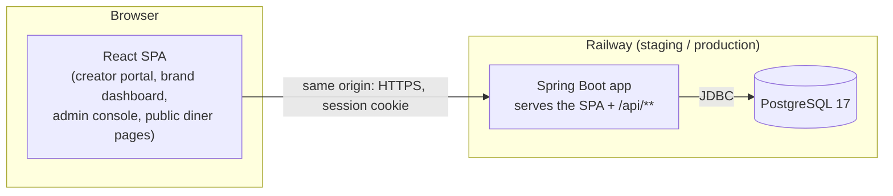

# Flavors architecture

This is how Flavors is built and why. Each section says whether it is **built** or still **planned**;
planned parts are the agreed design for EEC-27 (project foundation) and later stories.

## 1. Overview



- **One deployable.** The Spring Boot jar serves the built React files *and* the JSON API from the
  same origin. So there is no CORS, the browser sends the session cookie on its own, and each
  environment is one service plus one database.
- **Monorepo:** `backend/` (Maven), `frontend/` (Vite), `docs/`, with one `Dockerfile` at the root
  that builds both.

| Layer | Choice | Why |
|---|---|---|
| Language/runtime | Java 25 (LTS) | Agreed by the team; current LTS |
| Framework | Spring Boot 4.1 (Maven) | Agreed stack; Maven is the most familiar build tool for the team |
| Database | PostgreSQL 17 | Agreed stack; triggers make the append-only audit log possible |
| Migrations | Flyway (SQL files) | The schema is reviewable SQL, versioned in git |
| Frontend | React + TypeScript + Vite | Lighter than Angular for a forms-and-dashboards app |
| Hosting | Railway | Docker deploys, managed Postgres, built-in environments, low cost |
| CI/CD | GitHub Actions | Lives next to the code; free for this use |

## 2. Environments and branches

| Environment | Runs | Deployed when | Database |
|---|---|---|---|
| local | `./mvnw spring-boot:run` (profile `dev`) + `npm run dev` | — | Docker Compose Postgres, or Testcontainers |
| staging | Railway `staging` | Every push to `develop` (after CI passes) | Railway Postgres (staging) |
| production | Railway `production` | Push to `main` (a release PR was merged), after a reviewer approves the deployment | Railway Postgres (production) |

Branch model: `main` ← `release/sprint-N` ← `develop` ← `EEC-NN-short-name`. Details are in
[README.md](README.md#branch-conventions).

## 3. Backend

### 3.1 Package layout (by feature)

```
com.flavors
├── FlavorsApplication
├── common/              cross-cutting, used by every feature
│   ├── audit/           AuditLogEntry, AuditLogRepository, AuditLogger           (planned)
│   ├── idempotency/     IdempotencyKey, IdempotencyService                       (planned)
│   ├── money/           Money (USD cents value object)                           (planned)
│   ├── security/        SecurityConfig, Role, CurrentUser, 401/403 handlers      (planned)
│   └── web/             SpaForwardingController, global exception handler        (planned)
├── account/             AppUser, AdminSeeder, MeController                       (planned)
└── campaign/, offer/, payment/, …   one package per feature, added by later stories
```

Rule: a feature package may use `common`, but `common` never depends on a feature package.

### 3.2 Configuration — built

- `application.yml` holds the shared settings. Profiles `dev`, `staging` and `prod` override them, selected with
  `SPRING_PROFILES_ACTIVE`.
- The datasource is built from the variables Railway exposes (`PGHOST`, `PGPORT`, `PGDATABASE`, `PGUSER`,
  `PGPASSWORD`). The base file has **no defaults**, so a misconfigured environment fails at startup; only
  `application-dev.yml` has local defaults.
- `ddl-auto: validate`: Flyway owns the schema, and Hibernate only checks that entities match it.
- `open-in-view: false`; timestamps are read and written in UTC.
- `server.forward-headers-strategy: framework`: Railway terminates HTTPS at its proxy, so the app reads
  `X-Forwarded-*` to know the original request was HTTPS.
- Actuator exposes only `/actuator/health` (Railway's health check and the CI smoke test poll it).
- The full list of environment variables is in [README.md](README.md#environment-variables).

### 3.3 Testing — built

- **Unit tests** (`*Test`) run in `mvn test` (Surefire). **Integration tests** (`*IT`) run in `mvn verify`
  (Failsafe).
- Tests that touch the database import `TestcontainersConfiguration`, which starts a throwaway
  `postgres:17-alpine`; `@ServiceConnection` points the datasource at it. Tests therefore run the real
  migrations against real Postgres, so the triggers, constraints and SQL behave as they do in production.
- `TestFlavorsApplication` runs the app locally against a Testcontainers database.

## 4. Data model — planned

### 4.1 Conventions

| Topic | Rule | Why |
|---|---|---|
| Schema changes | Only through Flyway files `backend/src/main/resources/db/migration/V<n>__<name>.sql`. **Never edit a migration that is already merged**; add a new one | Flyway checksums applied files; staging/prod already ran them |
| Primary keys | `bigint generated always as identity` | Simple and compact; public-facing identifiers (storefront slug, QR token) are separate random values |
| Time | `timestamptz`, stored in UTC | No time-zone ambiguity; the UI formats for display |
| Money | `bigint` columns named `*_cents`, USD only | No floating-point rounding errors in fees and ROI |
| Status/enum columns | `varchar` + `CHECK (col IN (...))` | Easier to evolve and to map with JPA than Postgres enum types |
| Foreign keys | Always indexed; **no `ON DELETE CASCADE` on business data** | NF-8: campaign records are kept 5 years, and nothing is hard-deleted by accident |
| JPA entities | Written by the story that first uses a table | The schema is agreed up front; code arrives with the behaviour |

### 4.2 Tables by migration

The full MVP model is created in EEC-27 so that every story builds on one agreed schema.

**V1 — foundation**
- `app_user`: email (unique, case-insensitive), password_hash, role ∈ {CREATOR, BRAND, ADMIN},
  status ∈ {ACTIVE, SUSPENDED}, created_at, updated_at
- `password_reset_token`: user_id, token_hash, expires_at, used_at (UC-F19.3)
- `audit_log`: append-only, see §6
- `idempotency_key`: see §7
- Spring Session JDBC tables (`spring_session`, `spring_session_attributes`)

**V2 — accounts**
- `creator_profile`: user_id (PK/FK), display_name, bio, food_category, location, price_min_cents,
  price_max_cents (CHECK min ≤ max), verification_status ∈ {PENDING_APPROVAL, APPROVED, REJECTED},
  rejection_reason, reviewed_by, reviewed_at, storefront_slug (unique)
- `social_account`: creator_id, platform, external_id, access_token_enc, status ∈ {CONNECTED,
  NEEDS_RECONNECTION}, followers, engagement_rate, last_pulled_at
- `social_post_metric`: social_account_id, external_post_id, campaign_id (nullable), views, likes,
  comments, shares, pulled_at
- `brand`: user_id (PK/FK), business_name, contact_person, phone
- `branch`: brand_id, name, location
- `profile_warning`: user_id, campaign_id, reason, created_at (F9 cancellation warnings)

**V3 — campaigns**
- `campaign`: brand_id, creator_id, name, status ∈ {DRAFT, AWAITING_CREATOR_RESPONSE, COUNTERED,
  REJECTED, DECLINED, EXPIRED, AWAITING_PAYMENT, ACTIVE, PROOF_SUBMITTED, CORRECTIONS_REQUESTED,
  DISPUTED, COMPLETED, CANCELLED, REMOVED}, price_offered_cents, agreed_price_cents, start_date,
  last_posting_date, posting_extension_used, content_requirements, sent_at,
  response_deadline (Timer A), accepted_at, payment_deadline (Timer B),
  proof_review_deadline (Timer C), correction_rounds_used (CHECK ≤ 2), removed_reason,
  created_at, updated_at
- `campaign_branch`, `campaign_deliverable` (platform, type, count)
- `counter_offer`: campaign_id (**unique**, so there is only one counter-offer), price_cents, deliverables (jsonb),
  status, decided_at
- `cancellation`: campaign_id, cancelled_by, stage, outcome, created_at
- `review`: campaign_id (unique), rating (CHECK 1–5), text, created_at

**V4 — offers and redemptions**
- `offer`: campaign_id (unique), discount_percent (CHECK 1–100), expires_at, valid_days (bitmask),
  valid_from / valid_to (time), all_branches, min_purchase_cents, max_redemptions,
  per_person_limit (default 1)
- `offer_branch`
- `offer_claim`: offer_id, phone_enc (bytea), phone_hash (for lookups, NF-14), consent_at,
  qr_token (unique), status ∈ {UNUSED, REDEEMED}, created_at
- `redemption`: claim_id (**unique**, so a double scan registers once, FR-F11.7), offer_id,
  campaign_id, creator_id, brand_id, branch_id, bill_cents, discount_cents, redeemed_at
- `scan_failure`: qr_token, branch_id, bill_cents, reason, created_at (FR-F11.5)

**V5 — payments, proof, disputes, notifications**
- `escrow_payment`: campaign_id (unique), status ∈ {PENDING, HELD, RELEASED, FROZEN, REFUNDED},
  amount_cents, fee_cents, creator_net_cents, refunded_cents, provider, provider_payment_id (unique),
  held_at, released_at
- `payment_transaction`: escrow_id, type ∈ {CHARGE, RELEASE, REFUND}, status, amount_cents,
  provider_ref (unique), idempotency_key, created_at (history for F23)
- `proof_submission`: campaign_id, round, status ∈ {DRAFT, SUBMITTED}, submitted_at; unique
  (campaign_id, round) for submitted rows
- `proof_link`, `proof_file` (storage_key, content_type, size_bytes)
- `proof_review`: submission_id, decision ∈ {APPROVED, CORRECTIONS_REQUESTED, REJECTED}, reason,
  decided_by, decided_at
- `dispute`: campaign_id (unique), origin ∈ {REJECTION, CANCELLATION}, opened_at, evidence_deadline,
  status ∈ {OPEN, DECIDED}, creator_share_percent (CHECK 0–100), decided_by, decided_at
- `dispute_evidence`, `notification` (user_id, campaign_id, type, message, read_at, created_at)

A Mermaid ER diagram and a table → story map will be added here with V5.

## 5. Security — planned

- **Roles:** `CREATOR`, `BRAND`, `ADMIN` (Spring authorities `ROLE_*`). Diners and cashiers have
  no account: diner pages are *public* (unauthenticated), and the cashier's scan page runs inside
  the restaurant's BRAND session.
- **URL rules** (`SecurityFilterChain`):

  | Path | Access |
  |---|---|
  | `/api/public/**` | everyone (storefront, offer claim, QR page) |
  | `/api/creator/**` | CREATOR |
  | `/api/brand/**` | BRAND |
  | `/api/admin/**` | ADMIN |
  | other `/api/**` | any logged-in user |
  | `/actuator/health`, SPA files and routes | everyone |

- **Finer checks** use method security (`@PreAuthorize`) inside features, e.g. "this campaign
  belongs to the current brand" (NF-1).
- **Errors:** JSON `ProblemDetail`. **401** means not logged in, **403** means logged in with the wrong role.
  There are no redirects to a login page; the SPA decides what to show.
- **Sessions:** server-side sessions stored in Postgres (Spring Session JDBC), so users stay logged in
  across redeploys. The cookie is HttpOnly, Secure (staging/prod) and SameSite=Lax.
- **CSRF:** on, using Spring Security's SPA mode. The token travels in a cookie that the frontend
  echoes back in a header.
- **Passwords:** BCrypt (delegating encoder). Suspended users can't log in (FR-F19.12).
- **Scope split:** EEC-27 builds the mechanism, the guards and `GET /api/me`. The login, logout and
  password reset endpoints and screens belong to UC-F19.3.

## 6. Audit log (NF-7) — planned

"Every important action stores user, date and time; these records cannot be edited or deleted."

- **Table** `audit_log`: id, occurred_at (DB clock, `now()`), actor_user_id (nullable),
  actor_label (e.g. email or `system`), action, entity_type, entity_id, details (jsonb).
- **Guarantee at the database level:** a `BEFORE UPDATE OR DELETE` row trigger and a `BEFORE TRUNCATE`
  statement trigger raise an exception. This holds even if application code tries, through JPA,
  JDBC or a mistaken bulk query.
- **App level:** `AuditLogEntry` is `@Immutable` with no setters. `AuditLogRepository` extends Spring's
  bare `Repository` and exposes only `save` and finders, so there is no delete or update to call.
- **API:** `AuditLogger.record(action, entityType, entityId, details)` takes the actor from the security
  context (or `system` for jobs and the seeder). It joins the caller's transaction, so the audit row
  and the business change commit or roll back together.

## 7. Idempotency (NF-6) — planned

"A failed payment or decision is retried without creating a duplicate."

`IdempotencyService.execute(scope, key, requestFingerprint, action, resultType)`:

1. `INSERT ... ON CONFLICT DO NOTHING` an `IN_PROGRESS` row for (scope, key), then
   `SELECT ... FOR UPDATE`. The row lock makes concurrent retries wait for each other.
2. If the row is `COMPLETED` with the same fingerprint, return the stored response without running the action.
3. If the fingerprint differs (same key reused for a different request), reject with a conflict.
4. Otherwise run the action, store its response as JSON and mark the row `COMPLETED`, all in one
   transaction. If the action throws, everything rolls back and a later retry can run it again.

Planned uses: the Pay button (`Idempotency-Key` header, UC-F7.1), payment-provider webhooks
(scope `webhook:<provider>`, key = event id, EX-F7.1.3), and release, refund and dispute decisions
(UC-F7.2, F8.1). QR double scans are handled by the `redemption.claim_id` unique constraint instead.

## 8. Admin account seeding — planned

- `AdminSeeder` runs at startup when `FLAVORS_SEED_ADMIN_ENABLED=true`. It reads
  `FLAVORS_ADMIN_EMAIL` / `FLAVORS_ADMIN_PASSWORD`, and creates the ADMIN user (BCrypt hash) plus an
  `ADMIN_SEEDED` audit entry **only if that email doesn't exist yet**, so it is safe to run on every start.
  It fails fast if enabled without credentials.
- No password is ever in git or in a migration.

## 9. Money and language — planned

- The API exchanges **integer cents** only. The backend `Money` value object (long cents, HALF_UP percentage
  maths) is used for fees (15%), refunds and ROI.
- The frontend formats with `Intl.NumberFormat('en-US', {style: 'currency', currency: 'USD'})`, e.g.
  `formatUSD(123450)` → `$1,234.50`. Locale and currency constants live in `frontend/src/lib/locale.ts`.
- The UI is English only, with no i18n framework yet; Arabic is out of the MVP (NF-16).

## 10. Frontend — planned

- Vite + React + TypeScript, React Router, ESLint + Prettier, Vitest + Testing Library.
- `api/client.ts`: a fetch wrapper that sends credentials and the CSRF header and parses ProblemDetail errors.
- `useMe()` + `<RequireRole role="...">`: redirect to `/login` on 401 and show "Not allowed" on 403.
- Route areas: `/creator/*`, `/brand/*`, `/admin/*`; public `/s/:slug` (storefront) and
  `/claim/:token` (diner QR page).
- In dev, Vite proxies `/api` to `localhost:8080`. In production, `SpaForwardingController` sends
  non-API, non-file paths to `index.html` so client-side routes work on reload.
- The UI kit is chosen by the first UI story.

## 11. Build, deploy and CI/CD — planned

- **Dockerfile** (multi-stage): `node:22` builds the frontend → Maven (Temurin 25) packages the jar
  with the SPA in `static/` → `eclipse-temurin:25-jre` runs it as a non-root user on `$PORT`.
- **`docker-compose.yml`**: local Postgres 17 only.
- **`.github/workflows/ci.yml`**, on PRs and pushes to `develop`, `release/**` and `main`:
  `backend` (`./mvnw -B verify`), `frontend` (lint, test, build) and `docker` (image builds).
  `deploy-staging` runs only on push to `develop`, after all three pass: it runs `railway up` to staging and then a health smoke test.
- **`.github/workflows/deploy-production.yml`**: on push to `main`, plus `workflow_dispatch` as a
  manual fallback. It re-runs CI, then waits for the GitHub `production` environment's required reviewer
  before running `railway up` to production and a health smoke test.
- **Railway** (manual setup): project `flavors` with environments `staging` and `production`, each with a
  Postgres service and an `app` service (Dockerfile build, health check `/actuator/health`). GitHub
  secrets `RAILWAY_TOKEN_STAGING` and `RAILWAY_TOKEN_PRODUCTION` hold the deploy tokens.
